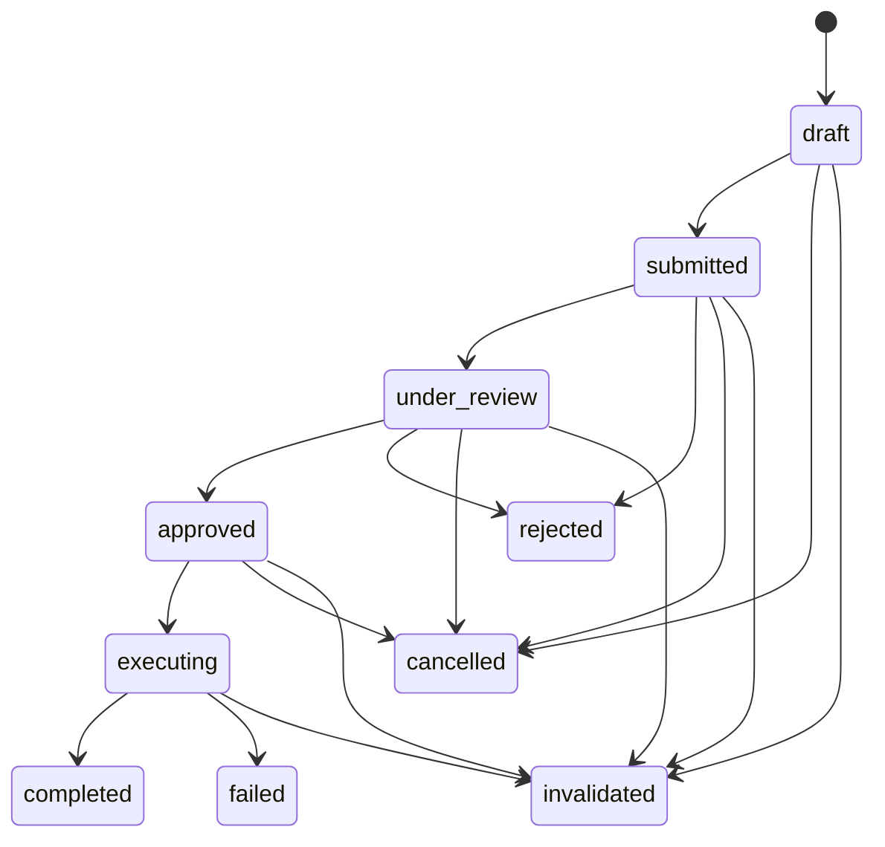

# Agent Authority Model

## Purpose

DEHPS separates research definition, engineering implementation, independent review, and operational execution. An Agent Request is an auditable authorization record; it is not an execution engine and never overrides the Hypothesis Registry or Promotion Gate.

The governing rule is default deny: a role may perform only an explicitly listed action, for an explicitly typed request, in an allowed lifecycle state and environment.

## Roles and authority

| Role | May do | Must not do |
| --- | --- | --- |
| Research | read the registry; propose hypotheses, preregistration, plans, Evidence, and decisions; request an experiment tool | modify code, run Shell, create Git/PR changes, operate infrastructure, directly change Hypothesis status |
| Engineering | implement approved code/tool/test/runtime requests in a non-production boundary | create or revise research claims, add Evidence, decide Hypothesis outcomes, alter the approved scientific contract |
| Reviewer | begin review, approve, reject, invalidate, and append Decisions | modify or execute reviewed work, rewrite results or history |
| Operator | execute approved isolated runs, migrations, restarts, and releases with a run ID | define research, alter algorithms, bypass review or Promotion |

No role has `promote_production_strategy`. Production strategy promotion remains exclusively controlled by the existing Promotion Gate.

## Policy evaluation

`AgentAuthorityPolicy.authorize(AuthorizationContext)` evaluates, in order:

1. environment validity and the permanent Promotion denial;
2. hard Research/Engineering/Reviewer/Operator separation;
3. the explicit Role → Action matrix;
4. the typed request's initiator, reviewer, or executor roles;
5. approval status before execution;
6. request-specific code and production permissions.

Anything not matched is denied. Production is stricter than isolated/development execution, and critical request review is reserved for Reviewer authority.

## Persistent records

`agent_requests` stores the typed immutable-after-approval contract and optional links to a Hypothesis, Experiment, and parent request. Submitted requests cannot be deleted.

`agent_request_decisions` is append-only. Every status transition and actor is recorded in the same database transaction as the status update.

`agent_request_executions` stores the executor role/ID, action, environment, run ID, result, artifacts, and structured error. Operator execution requires a run ID.

The database rejects direct status changes unless the Repository sets its transaction-local guard. It also rejects Decision update/delete and payload changes after an approval Decision, including requests later cancelled.

Terminal requests do not reopen in place. A new request with an optional parent link preserves the rejected or failed record.

## Research and Engineering handoff

A `engineering_experiment_tool` request freezes the Hypothesis/Experiment keys, scientific question, input boundary, tool interface, baseline, metric, failure condition, non-goals, and `production_impact: "none"`.

Engineering completion can return only:

- implementation commit reference;
- test commands and structured results;
- artifact paths;
- interface contract;
- known limitations.

It cannot return “hypothesis accepted”, “hypothesis rejected”, “signal exists”, or “predictive lift proven”. Implementation completion creates neither Hypothesis Evidence nor a research Decision.

Research must separately create or confirm an Experiment and submit an `operator_isolated_run`. Only a completed, audited Operator isolated execution may be cited by a `research_evidence_submission`. Review still does not automatically write the Hypothesis Registry.

## Interfaces

The `dehps agent` CLI creates and advances audit records and offers database-free authorization dry-runs. It has no Shell, Git, Supervisor, or strategy-promotion command.

The NestJS API is read-only:

- `GET /agent/requests`;
- `GET /agent/requests/:key`;
- `GET /agent/requests/:key/decisions`;
- `GET /agent/requests/:key/executions`;
- `GET /agent/authority`.

The authority response contains only public roles, actions, permissions, and the Promotion reservation; it returns no credentials.

## Trust boundary

Round 21 validates an asserted role and actor identifier. Authentication and signed workload identity are intentionally outside this round. Deployment must not treat a caller-supplied role as authenticated identity until an external identity layer binds it.
