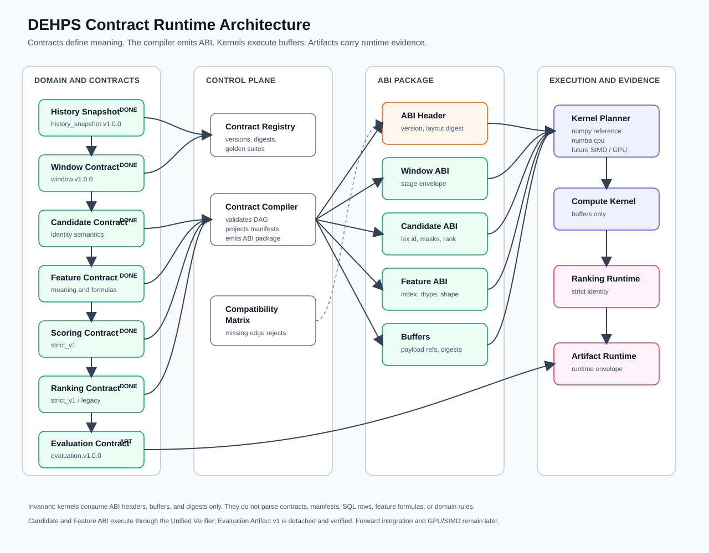

# DEHPS Contract Runtime Architecture

## Purpose

DEHPS is a contract-driven discrete computation runtime. The SSQ red-ball domain is the first domain, not the runtime boundary.

The runtime rule is:

```text
Domain facts -> Contracts -> Contract Compiler -> ABI Package -> Kernel -> Artifacts
```

A compute backend never interprets history, draw rules, candidate meaning, feature names, or manifests. It receives a validated ABI package: headers, shapes, strides, buffers, and digests. If the package does not match the backend's accepted contracts and layouts, execution fails closed.

## Runtime diagram



The diagram is intentionally not a Mermaid pipeline. The runtime is a DAG: Candidate identity feeds feature construction, scoring, ranking, and evaluation; history feeds windows; windows feed features; ranked predictions and outcomes feed evaluation.

## Contract, manifest, ABI, artifact

DEHPS uses these terms narrowly:

| Term | Meaning | Consumed by |
| --- | --- | --- |
| Contract | Normative semantics and compatibility identity | Control plane |
| Manifest | Auditable data or feature specification under a contract | Control plane |
| ABI | Packed machine layout compiled from contracts and manifests | Kernels |
| Artifact | Durable result plus runtime envelope and payload digest | Humans, APIs, downstream stages |

Examples:

- Candidate Contract defines canonical candidate identity semantics.
- Universe Manifest fixes a concrete `domain_size` and `pick_count` universe.
- Candidate Manifest names one canonical candidate subset under that universe.
- Candidate ABI defines row id dtype, combination encoding, mask layout, shape, and rank/unrank buffers.
- Candidate Set Artifact records a specific candidate payload digest under that ABI.

Changing a candidate filter changes a manifest or artifact. It must not change Candidate ABI unless the machine representation or identity semantics changed.

## Runtime layers

### Domain layer

The domain layer reads and normalizes source facts. In the current SSQ domain, this includes issues, draw dates, red numbers, target issues, and candidate universes.

Domain objects are not kernel inputs. They must be compiled into contract-aware artifacts before reaching a backend.

### Contract registry

The registry owns immutable contract references:

```text
family
semantic_version
schema_version
normative_digest
golden_suite_digest
```

Semantic version alone is not authority. Consumers carry explicit compatibility requirements for accepted versions, schema versions, and normative digests.

### Contract compiler

The compiler validates the Contract DAG and projects it into an ABI package.

Inputs include:

- history snapshot artifacts;
- window specs and window artifacts;
- candidate contracts, universe manifests, and candidate set artifacts;
- feature contracts and feature manifests;
- scoring, ranking, and evaluation contracts;
- backend capability declarations;
- explicit compatibility matrices.

Outputs include:

- a runtime envelope;
- ABI headers;
- layout digests;
- payload buffer digests;
- packed buffers;
- backend execution constraints.

The compiler is the only layer that may interpret manifests. Kernels never parse JSON, YAML, SQL rows, feature formulas, or domain names.

### Kernel planner

The planner selects a backend that can execute the ABI package:

- `numpy_reference`;
- `numba_cpu`;
- future SIMD/native CPU;
- future CUDA/OpenCL/device-resident backend.

Backend selection may change mechanics, parallelism, memory locality, and reduction strategy. It may not change contract semantics, score identity, rank identity, or artifact identity.

### Artifact runtime

The artifact runtime writes standalone evidence. A JSON, Markdown, Parquet, Arrow, or database row should remain auditable outside the database because its runtime envelope names the contracts, layouts, code, backend, and payload digests that produced it.

## ABI package

The long-term ABI package shape is:

```yaml
abi_package:
  version: abi_package.v1
  runtime_envelope_version: runtime_envelope.v1
  contracts:
    history_snapshot: history_snapshot.v1.0.0
    window: window.v1.0.0
    candidate: candidate.v1.0.0
    feature: feature.v1.0.0
    scoring: dehps-scoring-strict-v1
    ranking: strict_v1
    evaluation: evaluation.v1.0.0
  digests:
    history_snapshot: sha256:...
    window_artifact: sha256:...
    candidate_manifest: sha256:...
    candidate_layout: sha256:...
    candidate_payload: sha256:...
    feature_layout: sha256:...
    buffer_layout: sha256:...
    abi_package: sha256:...
  headers:
    window_abi: ...
    candidate_abi: ...
    feature_abi: ...
    scoring_abi: ...
    ranking_abi: ...
  buffers:
    window_buffer: pointer-or-artifact-ref
    candidate_buffer: pointer-or-artifact-ref
    feature_buffer: pointer-or-artifact-ref
```

The exact serialization can evolve, but the boundary cannot: kernels receive ABI headers, buffer references, and digests, not semantic manifests.

## Runtime envelope

Every durable artifact should converge on a top-level runtime envelope:

```yaml
runtime:
  envelope_version: runtime_envelope.v1
  artifact_type: scoring_kernel_result
  domain: ssq_red_ball
  state: artifact_produced
  state_path: [compiled_abi, verified_runtime, kernel_ready, kernel_executing, artifact_produced]
  history:
    contract: history_snapshot.v1.0.0
    snapshot_digest: sha256:...
    latest_issue: "2026080"
    draw_count: 3477
  window:
    contract: window.v1.0.0
    artifact_digest: sha256:...
  candidate:
    candidate_contract: candidate.v1.0.0
    candidate_abi: candidate_abi.v1
    candidate_digest: sha256:...
    layout_digest: sha256:...
    package_digest: sha256:...
  feature:
    contract: feature.v1.0.0
    abi_version: feature_abi.v1
    layout_digest: sha256:...
  scoring:
    contract: dehps-scoring-strict-v1
    backend: feature_abi_numpy_reference
  ranking:
    contract: strict_v1
  evaluation:
    contract: null
  code:
    commit: full-git-sha
  abi_package_digest: sha256:...
  artifact_payload_digest: sha256:...
```

This envelope is not a replacement for stage envelopes. A stage envelope carries the minimal dependencies needed to validate one stage. The runtime envelope is the top-level provenance record for durable artifacts.

## Current contract DAG status

| Node | Status | Notes |
| --- | --- | --- |
| History Snapshot Contract | Implemented | `history_snapshot.v1.0.0` red-ball scoring projection |
| Window Contract | Implemented | `window.v1.0.0`, rolling/expanding value object and stage envelope |
| Candidate Contract / ABI | Runtime preflight integrated | `candidate.v1.0.0`, `candidate_abi.v1`, Compiler, Verifier, golden fixtures, CandidateStore adapter, Kernel prepare validation, telemetry propagation |
| Feature Contract / Compiler | Reference compiler implemented | `feature.v1.0.0`, component manifest, golden vector, verified Window/Candidate input binding, deterministic Feature Artifact, fail-closed artifact verifier |
| Feature ABI Runtime | NumPy and Numba execution integrated | `feature_abi.v1`, tile-local dense `float64[R,32]`, joint Candidate/Feature preflight, sealed `VerifiedRuntimePackage`, explicit Kernel Planner entries, strict score/rank/TopK/Red5 execution; the older component-producing fused Numba entry remains separate |
| Runtime ABI Cache | Control-plane capability implemented | `runtime_abi_cache.v1`, complete Contract DAG key, no-copy read-only Feature buffers, verifier-gated hits, byte/entry bounded LRU, dependent Runtime eviction |
| Runtime Envelope | Feature ABI KernelResult integrated | `runtime_envelope.v1`, full History/Window/Candidate/Feature/Scoring/Ranking/code binding, backend identity, canonical state path, detached payload verification; legacy artifacts are not rewritten |
| Unified Runtime Verifier | Feature ABI paths enforced | `unified_runtime_verifier.v1` mints sealed `verified_runtime_package.v1`; NumPy/Numba Planner paths and Envelope Compiler reject raw runtime inputs |
| Scoring Contract | Implemented | `dehps-scoring-strict-v1` |
| Ranking Contract | Implemented | `legacy_score_partition` compatibility and `strict_v1` |
| Evaluation Contract / Artifact | [Forward integration implemented](forward-evaluation-artifact-integration-v1.md) | `evaluation.v1.0.0`, Prediction/Outcome/Ranking Audit parents, source Runtime Envelope binding, Stage Envelope, metric recomputation, Candidate ABI membership, detached fail-closed verification, and one-finalize forward persistence |

## Compatibility matrix

Every compiled ABI package must satisfy an explicit compatibility matrix. Examples:

```text
window.v1.0.0 -> feature.v1.0.0: allowed
window.v2.0.0 -> feature.v1.0.0: reject
candidate.v1.0.0 -> candidate_abi.v1 reference compiler/verifier: allowed
candidate_abi.v1 -> production scoring strict_v1: allowed through verified CandidateStore adapter
feature.v1.0.0 -> feature_abi.v1 reference compiler/verifier: allowed
feature_abi.v1 -> runtime_abi_cache.v1: allowed only with per-hit Feature and Unified Runtime revalidation
feature_abi.v1 -> Kernel Planner -> feature_abi_numpy_reference: allowed after Unified Runtime verification
feature_abi.v1 -> Kernel Planner -> feature_abi_numba_cpu: allowed after the same Unified Runtime verification
legacy fused numba_cpu -> Feature ABI producer: not claimed; requires a separately verified producer
candidate_abi.v2 -> candidate.v1.0.0: reject until explicitly specified
```

There is no implicit "same major version" compatibility rule. A missing compatibility edge is a rejection, not a warning.

## Kernel boundary

The kernel boundary is intentionally narrow:

Allowed:

- ABI version;
- numeric buffers;
- fixed dtypes;
- shapes and strides;
- scalar flags;
- layout digests;
- payload digests;
- backend capability flags.

Forbidden:

- SQL reads;
- JSON/YAML manifest parsing;
- feature formula interpretation;
- issue/date parsing;
- candidate filtering semantics;
- domain-specific rule checks;
- warning-only contract fallback.

This is the boundary that lets NumPy, Numba, SIMD, CUDA, OpenCL, and future native backends remain interchangeable implementations of the same runtime.

## Migration order

The next migration rounds should be staged as:

1. Explicit caller migration: adopt Runtime ABI Cache and forward Evaluation Artifact capabilities without changing prediction identity or backend defaults.
2. Fused producer migration: define and verify any zero-materialization Feature tile producer before claiming ABI compliance or changing defaults.
3. Shadow completion: collect the required simultaneous, post-draw, three-issue zero-difference evidence before a backend-default decision.
4. Future backends: SIMD, CUDA, OpenCL, or Rust implementations must accept the same verified runtime and reproduce the same Golden fixtures and artifact payload digest.

Non-goals for this architecture document:

- no production prediction regeneration;
- no pending candidate rewrite;
- no database migration;
- no backend default switch;
- no feature, scoring, ranking, or evaluation behavior change.
