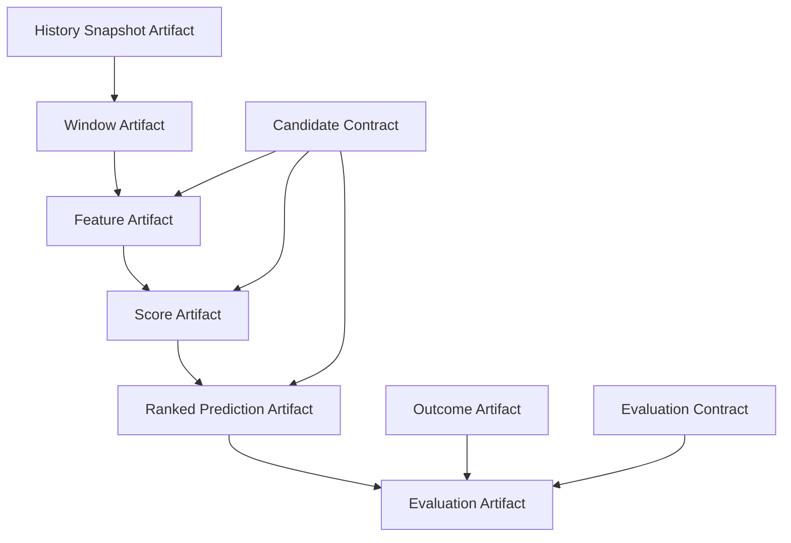

# DEHPS Scoring Input Contract v1

## Architecture principle

DEHPS is a contract-driven research runtime. Domain code defines facts and semantics; the control plane validates immutable contracts and compiles concrete artifacts; compute backends consume only validated stage envelopes and packed ABI buffers.

> A Kernel does not understand history, draw rules, SSQ, or feature names. It executes one frozen ABI. A contract mismatch fails closed.

The broader runtime boundary is described in [Contract Runtime Architecture](contract-runtime-architecture.md).

The complete execution model is a dependency graph rather than a linear pipeline:



This round freezes the first edge only: `History Snapshot -> Window`. Candidate, Feature, Evaluation, and a full Execution Envelope remain later staged contracts.

## Contract identity

Every executable contract reference contains:

| Field | Meaning |
| --- | --- |
| `family` | Stable contract family, for example `window` |
| `semantic_version` | Human compatibility version, for example `1.0.0` |
| `schema_version` | Serialization schema of the normative definition |
| `normative_digest` | SHA-256 identity of canonical normative semantics |
| `golden_suite_digest` | SHA-256 identity of executable conformance fixtures |

Semantic Version does not grant compatibility. Every consumer carries an explicit list of accepted versions, schema versions, and normative digests. A same-major contract not listed in that matrix is rejected.

Version policy:

- Patch may clarify non-normative documentation only; the normative digest and numerical behavior remain unchanged.
- Minor may add an explicitly optional, backward-compatible capability.
- Major changes an incompatible formula, layout, boundary, or numerical meaning.
- Fixing an implementation so it once again conforms to an unchanged contract changes the backend implementation version and code commit, not the contract.
- Any semantic output change requires a new normative identity.

Golden-suite changes do not alter artifact identity. They record conformance evidence, while `normative_digest` defines meaning.

## Canonical serialization

`dehps.contracts.canonical_json` is the sole identity serialization for the new contract runtime:

- object keys are sorted;
- separators and Unicode escaping are fixed;
- unordered collections are rejected;
- non-finite floats are rejected;
- datetimes require an explicit timezone and normalize to UTC;
- mappings require string keys;
- each digest is domain-separated before SHA-256.

There is no fallback to `repr`, implicit system time, database row identity, or object iteration order.

## History Snapshot Contract `history_snapshot.v1.0.0`

This first history contract is the red-ball scoring projection, not a complete SSQ result archive. Its identity fields are exactly:

```text
issue
draw_date
red_numbers
```

Normative rules:

- issue is exactly seven ASCII digits;
- rows are unique and strictly ascending by issue;
- `draw_date` is an ISO date or null;
- red numbers contain six unique integers in strictly ascending order, each in `[1,33]`;
- source, retrieval time, database row id, and process time are not identity fields;
- an empty snapshot is valid, but cannot produce a non-empty Window;
- any date, issue, or red-number revision changes `history_digest`, even when latest issue and draw count do not change.

The artifact exposes:

```text
snapshot_id
history_digest
first_issue
latest_issue
draw_count
contract reference
canonical records
```

The legacy research-runtime `history_fingerprint` remains unchanged. `HistorySnapshotManager.contract_current()` is an additive, opt-in read path so existing runs, pending predictions, fingerprints, and watchdog state are not reinterpreted.

## Window Contract `window.v1.0.0`

`WindowSpec` is the only new value object that interprets a History Snapshot:

```python
WindowSpec(
    mode="rolling",
    size=100,
    minimum_size=100,
    as_of_issue="2026080",
    include_as_of=True,
    target_issue="2026081",
)
```

Normative selection rules:

| Rule | Meaning |
| --- | --- |
| `as_of_issue` | Must exist in the referenced snapshot |
| `include_as_of=true` | Include that realized draw |
| `include_as_of=false` | Exclude that row, normally because it is the backtest target |
| `rolling` | Select at most the immediately preceding `size` rows through the cutoff |
| `expanding` | Select all rows before or through the cutoff; `size` must be null |
| `minimum_size` | Reject rather than silently train on fewer rows |
| `target_issue` | Must be strictly later than every selected issue |
| missing calendar issues | Preserve existing snapshot rows; never synthesize or impute a draw |

This freezes the existing DEHPS behavior:

```text
backtest rolling:  history[max(0, target_index-size):target_index]
backtest expanding: history[0:target_index]
forward rolling:   history[-size:]
forward expanding: history[:]
```

The direct slices above describe compatibility evidence only. New contract-aware callers use `WindowSpec.materialize(snapshot)`.

## Window Stage Envelope

The Window control-plane stage emits a tamper-evident envelope:

```text
abi_version
history_contract
window_contract
history_snapshot_digest
window_spec_digest
selected_payload_digest
input_draw_count
output_draw_count
envelope_digest
```

The Window Artifact is a Merkle-style identity over:

```text
artifact type
parent history digest
WindowSpec digest
selected payload digest
start/stop indices
```

The stage validates only its direct dependency, `history_snapshot.v1.0.0`. Future Scoring, Ranking, and Evaluation stage envelopes must likewise validate their own minimal dependency sets; changing a downstream Ranking Contract must not invalidate a reusable Score Artifact.

## Failure policy

The contract runtime rejects ambiguous input with structured codes, including:

- `invalid_issue_encoding`
- `history_issue_order_violation`
- `noncanonical_red_numbers`
- `as_of_issue_not_in_snapshot`
- `insufficient_window_history`
- `target_issue_leakage`
- `unsupported_contract_version`
- `unsupported_contract_schema`
- `contract_normative_digest_mismatch`
- `unsupported_abi_version`
- `window_spec_digest_mismatch`
- `window_payload_digest_mismatch`

There is no warning-only compatibility mode.

## Operational audit

The read-only audit entry point is:

```bash
cd apps/worker-python
.venv/bin/python -m scripts.audit_input_contract \
  --as-of-issue 2026080 \
  --target-issue 2026081 \
  --mode rolling \
  --size 100 \
  --minimum-size 100
```

Use `--exclude-as-of` for a backtest target already present in the snapshot. `--include-records` includes canonical records in the JSON output; the default emits metadata and digests only.

## Migration boundary

This first version intentionally does not replace every historical Python slice. It establishes an executable oracle and an opt-in database materializer without changing current training, prediction, evaluation, or persistence behavior. Later migration rounds can replace one characterized call surface at a time and prove exact window equality before removing direct slicing.

Non-goals:

- no Feature, Candidate, Scoring, Ranking, Outcome, or Evaluation contract;
- no feature, model, formula, filter, weight, or TopK change;
- no database migration or historical backfill;
- no production run regeneration or state transition;
- no backend switch, GPU, SIMD, or performance optimization.
