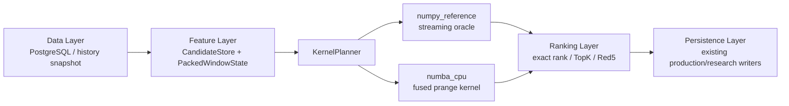

# DEHPS Scoring Kernel `strict_v1`

## Scope

`dehps-scoring-strict-v1` is the shared scoring and ranking contract for production prediction and deterministic research. It freezes the current 32-component frequency-ranker behavior behind a replaceable backend ABI. Backend selection may change execution mechanics, but it may not change a score, rank, TopK row, or Red5 result.

The production default remains `numpy_reference`. `numba_cpu` is opt-in:

```bash
DEHPS_SCORING_BACKEND=numba_cpu python -m scripts.run_weight_grid_search ...
```

The immediate rollback is:

```bash
DEHPS_SCORING_BACKEND=numpy_reference ...
```

## Numerical contract

| Item | Frozen behavior |
| --- | --- |
| Component dtype | `float64` |
| Weight dtype | `float64` |
| Score accumulation | NumPy reference ordering, verified after score rounding |
| Score normalization | `round(score, 8)` / `np.round(..., 8)` |
| Non-finite input | Reject `NaN` and positive/negative infinity before execution |
| Exact rank | `count(score > target) + count(score == target and lex_id < target_lex_id) + 1` |
| TopK | Score descending, then canonical lexicographic row id ascending |
| Red5 | `popcount(candidate_mask & target_mask) == 5` |

The contract forbids `float32`, `fastmath`, tolerance-based equality, implicit time-derived randomness, backend-specific tie handling, and a backend-specific FMA relaxation. Exact equivalence means `np.array_equal`, not `allclose`.

The pre-kernel compatibility helper previously selected the TopK boundary using score-only `argpartition`. When more candidates tied at the boundary than remaining slots, it sorted only an arbitrary tied subset. That contradicted its documented lexicographic tie rule and changed with selection mechanics. `strict_v1` fixes selection and ordering to the same score/lex contract. Existing persisted predictions and pending candidates are not rewritten.

## ABI and data plane



The stable control-plane types are:

- `CandidateStore`
- `PackedWindowState`
- `WeightMatrix`
- `KernelRequest`
- `KernelWorkspace`
- `KernelResult`
- `PreparedCandidateStore`
- `ScoringKernelBackend`

The hot data plane contains only fixed-shape, C-contiguous NumPy arrays and scalar flags. Candidate numbers are `uint8[N,6]`; membership masks and stable lexicographic codes are `uint64[N]`. Window dictionaries and tuple keys are projected once into dense lookup tables before backend execution. Issue strings, dates, Python callbacks, candidate tuples, candidate dataclasses, strings, dictionaries, and object arrays do not enter a scoring tile.

The canonical SSQ source space is `C(33,6) = 1,107,568`, in `itertools.combinations` lexicographic order. The current production hard-filter view has 1,105,506 rows; the scoring ABI supports either store without changing the kernel. The store version and source fingerprint are emitted with every run.

## Execution and memory model

`numpy_reference` is the readable oracle. It constructs components for one candidate tile, scores that tile, rounds it, reduces exact ranks, updates deterministic TopK/Red5 state, and reuses a preallocated score/mask workspace. It never retains a full candidate-by-config score matrix.

`numba_cpu` uses `njit(parallel=True, fastmath=False)` and `prange` over candidate rows. One compiled row loop computes all 32 components, accumulates every requested configuration, rounds the scores, updates thread-local exact-rank counters, and computes Red5 membership with a `uint64` popcount. Python sees only bounded tile score arrays for deterministic TopK merging. This is a fused compute/reduction kernel, not a JIT wrapper around a Python candidate loop.

## Shadow evidence boundary

Production backend promotion is governed by
`scoring-kernel-shadow-evidence.v1`, not by an ad-hoc benchmark. One comparison
executes `numpy_reference` and `numba_cpu` against the same `CandidateStore`,
packed window, weight matrix, and immutable `KernelRequest`. The evidence seals:

- target scores and exact ranks;
- strict TopK candidate row IDs and scores;
- Red5 candidate IDs, scores, and global ranks;
- Candidate ABI contract, layout, package, payload, and verified identity;
- backend-neutral Runtime Envelope dependencies when full envelopes are present;
- official and shadow result payload digests.

Array shapes must match. Floating-point tolerances, best-run selection, missing
identity repair, and silent fallback are forbidden. Runtime Envelope comparison
excludes only the deliberately different backend field; every shared contract,
history, window, candidate, feature, code, ABI package, and artifact payload
identity must remain equal.

The promotion-readiness gate requires the latest three target issues to be
consecutive. Each issue must contain sealed evidence for `static_100`,
`dynamic_kdj`, and `dynamic_kdj_near`; scoring comparison, post-draw evaluation,
restart recovery, and watchdog checks must all pass. Duplicate issue/line evidence
fails closed. The gate may return `ready_for_independent_approval`, but always
returns `automatic_promotion_allowed=false`: it has evidence authority, not
production promotion authority.

### Forward reconstruction adapter

`scripts.run_forward_scoring_shadow` is a read-only compensation and diagnostic
entry point for an already persisted `forward_prediction_run`. It reconstructs
the exact history boundary and configuration, executes both current backends,
and binds the result to the stored official TopK artifact and completed forward
evaluation. History fingerprint, configuration fingerprint, candidate count,
rank continuity, CandidateStore row identity, scores, leakage status, model rank,
and model score all fail closed.

Reconstruction is always recorded as `capture_mode=posthoc_reconstruction`, with
separate source and replay commits. It can expose historical differences, but it
cannot satisfy the promotion gate. Only `capture_mode=simultaneous`, produced at
the original prediction boundary with matching source/replay commit and an
explicit prediction run key, may count toward the three-issue cohort.

If a caller requests more workers than the Numba runtime exposes (for example, a two-core CI runner receiving `worker_count=4`), the backend caps execution to `NUMBA_NUM_THREADS`. Telemetry records the actual worker count. This changes capacity only; the strict result is invariant.

Red5's global rank requires a second bounded scoring pass using the selected Red5 score and lex id as the target. This preserves exact rank without retaining the first pass's full score matrix. Telemetry counts both passes in `score_cells`.

## Telemetry

Every kernel invocation appends JSONL to `runtime/logs/scoring-kernel.jsonl` unless `DEHPS_SCORING_TELEMETRY_PATH=off` is explicitly used for isolated tests. The record contains:

- backend and contract/store versions;
- candidate, config, window, chunk, and worker counts;
- score cells and estimated bytes read;
- prepare, feature, kernel, rank, TopK merge, wall, and CPU time;
- peak RSS and cells per second.

Benchmark evidence is generated by:

```bash
cd apps/worker-python
.venv/bin/python -m scripts.benchmark_scoring_kernel
```

That benchmark uses real historical windows, eight production grid configurations, the complete 1,107,568-candidate legal space, all required chunk sizes, and 1/2/4/8/16 Numba thread counts. It also records strict output digests, swap use, and cProfile Top30 output.

## Non-goals for `strict_v1`

This version does not add CUDA, OpenCL, GPU auto-selection, C++/Rust SIMD, fixed-point scoring, Arrow/Parquet migration, or a production-default switch to Numba. Those remain later backends or contracts and must pass this same oracle boundary before use.
