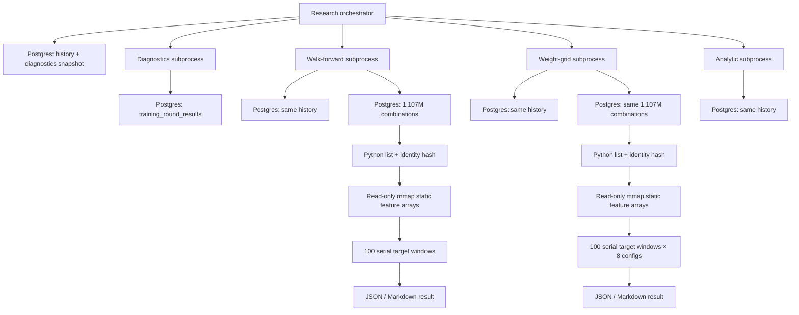
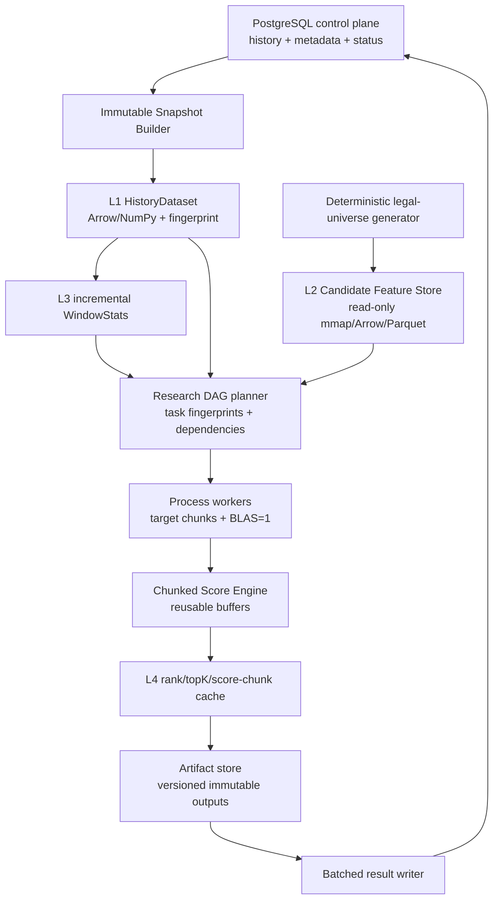

# DEHPS Research Lane 架构级性能审计

日期：2026-07-16

基线提交：`c756f540a5216796bdf56a59ddedc93d87510bce`

历史快照：`as_of_issue=2026080`

Operator 审计记录：Request 109 / Execution 32

原始证据：`runtime/performance-audit/research-lane-c756f54/`（本机运行态，不纳入 Git）

## 1. 执行摘要

核心结论：当前 CPU 低不是因为 Python 长时间等 PostgreSQL，而是因为 research lane 的重计算阶段基本按 target window 串行执行。命令虽然传入 `workers=16`，当前矩阵后端没有建立外层 worker pool；实测 `workers=1` 与 `workers=16` 仅有 `1.014x` 差异。NumPy/OpenBLAS 在局部归约和矩阵操作中使用少量 native 线程，因此整个进程平均只占用约 `2.08` 个逻辑核，而不是 16 个物理核。

完整 cProfile 画像中：

- 总 wall time：`376.548s`
- 总 process CPU time：`783.232s`
- 平均占用：`2.080` 个逻辑核，即 22 个逻辑 CPU 的 `9.45%`
- SQL：`13` 次、`6` 种规范化语句
- 数据库边界累计 wall：`3.083s`，仅占总 wall 的 `0.819%`
- 估算客户端 DB 等待：`1.865s`，仅占总 wall 的 `0.495%`
- 生产式、无 profiler 的同一 suite：`279.604s`；其中 walk-forward `137.502s`、weight-grid `141.026s`

因此，“系统一直在读 PostgreSQL”只描述了候选全集装载的短暂启动阶段，不能解释后续两分多钟的低 CPU。`pidstat` 在重计算阶段观测到约 `170%–240% CPU`、`0%–1% %wait`、`iodelay=0`、`kB_rd/s=0`；数据库连接也不在每个 window 或参数组合内执行 SQL。

当前实现没有 SQL N+1，但有跨任务重复数据装载：相同历史读取 4 次，相同 1,107,568 条组合全集读取 2 次。这个问题应修，但它只能节省当前总时长的约 `1%–3%`。真正能把 16 核用起来的 P0 是按 target-window chunk 建立真实的多进程执行层，并限制每个 worker 的 BLAS 线程数，防止嵌套过度并行。

## 2. 审计合同与方法

本轮只有一个目标：在不改变算法、模型、权重、特征、生产预测和数据库业务状态的前提下，建立可重复的性能证据。

固定参数：

| 参数 | 值 |
|---|---:|
| 历史截止期 | 2026080 |
| train mode | expanding |
| train window | 900 |
| evaluation window | 100 |
| top N | 10,000 |
| weight-grid 配置数 | 8 |
| 命令 workers | 16 |
| 候选源数量 | 1,107,568 |
| 硬过滤后候选 | 1,105,506 |

机器与运行环境：

| 项目 | 值 |
|---|---|
| CPU | Intel Core Ultra 7 155H |
| 物理核 / 逻辑 CPU | 16 / 22 |
| NUMA | 1 node |
| 内存 | 30 GiB 可见，基线约 26 GiB available |
| Python / NumPy | 3.14.4 / 2.4.6 |
| BLAS | scipy-openblas 0.3.31，默认 `MAX_THREADS=64` |
| PostgreSQL | 17.10，本机 Docker 网络 |

实际使用的观测手段：

- `cProfile` 以 `process_time` 记录 Python 与 native 调用的 CPU 时间；
- Psycopg connection/cursor 包装器记录每条规范化 SQL 的 execute、fetch、wall、客户端 CPU、行数和估算等待；
- `/usr/bin/time -v` 记录 wall、CPU、RSS、major fault 和文件系统块；
- `pidstat` 记录运行时 CPU、`%wait`、I/O delay、RSS 和线程数；
- `iostat` 记录系统块设备等待与利用率；
- 有界 `strace -c` 验证候选全集读取期间的 socket `poll/recvfrom`；
- 相同输入下执行 `workers=1/16` 的 20-window 对照实验；
- PostgreSQL relation counters 验证组合表全表读取次数；
- 本地 mmap 与数据库 list 两条数据路径做独立启动基准。

测量限制：

1. 内核设置 `perf_event_paranoid=4`，且进程没有 `CAP_PERFMON`，所以无法使用 Linux `perf` 硬件计数器。
2. PostgreSQL 未加载 `pg_stat_statements`，`track_io_timing=off`；SQL 时间来自应用边界，不冒充服务端执行计划时间。
3. cProfile 使整套 wall time 从 `279.604s` 增至约 `376.548s`，开销约 `34.7%`。因此 wall time 以无 profiler 运行作生产式参考，函数占比和调用路径以 profiler 运行作定位证据。
4. `process CPU / wall` 可大于 1，因为 native 数值库会在局部阶段并行；它表示所有线程 CPU 时间之和。

## 3. 每个训练阶段耗时

### 3.1 无 profiler 的生产式 wall time

| Stage | Wall time | Suite 占比 |
|---|---:|---:|
| Training diagnostics | 0.686s | 0.25% |
| Walk-forward | 137.502s | 49.18% |
| Weight-grid | 141.026s | 50.44% |
| Analytic null baseline | 0.389s | 0.14% |
| **Total** | **279.604s** | **100%** |

diagnostics 和 analytic baseline 不是容量问题。`99.6%` 的 suite wall time 位于 walk-forward 与 weight-grid。

### 3.2 cProfile 任务边界

| Task | Wall | Process CPU | 平均逻辑核 | DB boundary | 估算 DB wait | Max RSS |
|---|---:|---:|---:|---:|---:|---:|
| Orchestrator | 0.063s | 0.040s | 0.64 | 0.016s | 0.013s | 66.9 MiB |
| Diagnostics | 0.120s | 0.077s | 0.64 | 0.087s | 0.039s | 85.8 MiB |
| Walk-forward | 187.925s | 369.334s | 1.97 | 1.625s | 1.023s | 1,052.5 MiB |
| Weight-grid | 188.399s | 413.746s | 2.20 | 1.351s | 0.787s | 1,144.9 MiB |
| Analytic baseline | 0.042s | 0.035s | 0.83 | 0.004s | 0.003s | 65.9 MiB |
| **Total** | **376.548s** | **783.232s** | **2.08** | **3.083s** | **1.865s** | — |

### 3.3 重任务内部阶段

以下 stage 有嵌套关系，不能机械求和；它用于说明边界，不替代 task total。

| Task / stage | Calls | Wall | Process CPU | 解释 |
|---|---:|---:|---:|---|
| Walk / select history | 1 | 0.006s | 0.002s | 历史查询 |
| Walk / load combination universe | 1 | 1.828s | 0.810s | DB 传输 + Python 行转换 |
| Walk / run walk-forward | 1 | 186.043s | 368.479s | 100 个窗口的统计、评分、排名 |
| Walk / render report | 1 | 0.001s | 0.001s | 结果写文件 |
| Grid / select history | 1 | 0.006s | 0.002s | 历史查询 |
| Grid / load combination universe | 1 | 1.532s | 0.749s | DB 传输 + Python 行转换 |
| Grid / build ranked universe | 1 | 10.459s | 10.457s | list 身份计算与 mmap 解析；受 cProfile generator 开销放大 |
| Grid / rank target grid | 100 | 176.330s | 402.469s | 8 配置 × 100 target 的评分与排名 |
| Grid / summarize + report | 9 | 0.003s | 0.003s | 汇总与写文件 |

回答“CPU 在等待什么”：重计算期间并没有主要等待数据库或磁盘。外层 Python 控制流一次只推进一个 target window；单个 window 内发生大数组构造、内存复制、归约、round 和全数组词典序比较。部分 NumPy 操作用少量 native 线程，部分 Python/elementwise/memory-bound 操作只能用约一个核，平均结果约为 2 核。其他 14 个物理核没有可执行的独立 window 工作。

## 4. CPU 时间 Top 30 函数

百分比按全部 profile 的 `783.232s process CPU` 计算；self CPU 不重复计算子调用。

| # | Function | Calls | Self CPU | CPU 占比 | Cumulative CPU |
|---:|---|---:|---:|---:|---:|
| 1 | `walk_forward._components_for_matrix` | 201 | 120.183s | 15.35% | 248.191s |
| 2 | `walk_forward._lex_less_than` | 300 | 107.119s | 13.68% | 115.832s |
| 3 | `numpy.ufunc.reduce` | 2,587 | 89.802s | 11.47% | 89.802s |
| 4 | `numpy.column_stack` | 201 | 85.358s | 10.90% | 85.373s |
| 5 | `walk_forward._score_matrix` | 201 | 70.356s | 8.98% | 380.876s |
| 6 | `ndarray.round` | 301 | 68.734s | 8.78% | 68.734s |
| 7 | `walk_forward._rank_targets_from_scores` | 200 | 38.508s | 4.92% | 169.594s |
| 8 | `builtins.sum` | 4,097,856 | 19.771s | 2.52% | 34.721s |
| 9 | `frequency_ranker.normalize_history_draw` | 290,998 | 14.245s | 1.82% | 34.386s |
| 10 | `combination._coerce_red_number` | 3,500,382 | 11.122s | 1.42% | 19.441s |
| 11 | `walk_forward._materialize_universe` | 2 | 9.280s | 1.18% | 18.021s |
| 12 | `walk_forward.<genexpr>:1107` | 15,505,952 | 8.740s | 1.12% | 8.740s |
| 13 | `frequency_ranker.<genexpr>:373` | 1,150,951 | 7.926s | 1.01% | 7.926s |
| 14 | `combination.normalize_red_numbers` | 583,397 | 6.664s | 0.85% | 40.720s |
| 15 | `combination.<genexpr>:26` | 4,083,779 | 6.287s | 0.80% | 25.728s |
| 16 | `builtins.isinstance` | 7,593,191 | 6.051s | 0.77% | 6.052s |
| 17 | `builtins.len` | 2,943,205 | 5.861s | 0.75% | 5.862s |
| 18 | `frequency_ranker.train_frequency_stats` | 201 | 5.788s | 0.74% | 147.478s |
| 19 | `red_ball_features.calculate_red_ball_features` | 292,199 | 5.131s | 0.66% | 34.586s |
| 20 | `numpy.memmap.__getitem__` | 93,628 | 4.788s | 0.61% | 5.979s |
| 21 | `frequency_ranker.history_numbers` | 297,190 | 4.685s | 0.60% | 6.976s |
| 22 | `frequency_ranker.history_draw_date` | 303,183 | 4.679s | 0.60% | 6.625s |
| 23 | `frequency_ranker._shape_profile` | 291,198 | 4.589s | 0.59% | 43.756s |
| 24 | `walk_forward.rank_target_grid` | 200 | 4.577s | 0.58% | 700.968s |
| 25 | `ndarray.astype` | 3,216 | 4.558s | 0.58% | 4.566s |
| 26 | `frequency_ranker._even_count` | 290,998 | 4.392s | 0.56% | 22.091s |
| 27 | `numpy.memmap.__array_wrap__` | 10,434 | 3.788s | 0.48% | 4.833s |
| 28 | `builtins.sorted` | 585,824 | 3.729s | 0.48% | 29.471s |
| 29 | `frequency_ranker._normalized_rate` | 5,226 | 3.342s | 0.43% | 6.263s |
| 30 | `combination.<genexpr>:31` | 4,083,779 | 3.199s | 0.41% | 3.199s |

### 4.1 计算流归类

为避免把 cumulative CPU 重复相加，下表只组合不重叠的 self CPU 热点：

| 计算类别 | 代表函数 | Self CPU | 全部 CPU 占比 |
|---|---|---:|---:|
| 组件矩阵构造与复制 | `_components_for_matrix` + `column_stack` | 205.541s | 26.24% |
| 排名与词典序 tie-break | `_lex_less_than` + `_rank_targets_from_scores` | 145.627s | 18.59% |
| 打分与数值归约 | `_score_matrix` + `ufunc.reduce` | 160.158s | 20.45% |
| 分数量化 | `ndarray.round` | 68.734s | 8.78% |
| 历史统计、领域归一化、mmap 和其余调用 | 其余 self CPU | 203.171s | 25.94% |

数据库等待不是 CPU 类别：它是 `1.865s wall`，只占 profile wall 的 `0.495%`。不能把它与 `783.232s` 的多线程 process CPU 混为同一个分母。

## 5. 数据库访问分析

审计共观测到 13 次 SQL、6 种规范化 SQL。用户要求 Top 20，但实际只有 6 种，所以下表已是完整集合。

| # | SQL | Calls | Rows | 累计 boundary | 平均 | 客户端 CPU | 估算客户端 wait |
|---:|---|---:|---:|---:|---:|---:|---:|
| 1 | `SELECT numbers FROM ssq_red_combinations ORDER BY n1,n2,n3,n4,n5,n6` | 2 | 2,215,136 | 2.964s | 1.482s | 1.162s | 1.803s |
| 2 | `SELECT * FROM training_round_results WHERE run_id=%s ORDER BY round_index DESC LIMIT %s` | 1 | 8 | 0.087s | 0.087s | 0.049s | 0.039s |
| 3 | `SELECT max(draw_date) FROM ssq_history WHERE issue <= %s` | 4 | 4 | 0.012s | 0.003s | 0.003s | 0.009s |
| 4 | `SELECT run_id FROM training_round_results ORDER BY updated_at DESC,round_index DESC LIMIT 1` | 1 | 1 | 0.009s | 0.009s | 0.000s | 0.009s |
| 5 | `SELECT issue,draw_date,red_numbers FROM ssq_history WHERE draw_date >= %s AND issue <= %s ORDER BY issue` | 4 | 5,992 | 0.009s | 0.002s | 0.004s | 0.005s |
| 6 | `SELECT count(*)::int,max(round_index)::int,max(updated_at) FROM training_round_results WHERE run_id=%s` | 1 | 1 | 0.001s | 0.001s | 0.000s | 0.001s |

判断：

- **N+1 查询：没有。** 100 个 window 和 8 个参数配置内部均未发 SQL。
- **重复读取相同历史：有。** orchestrator、walk-forward、weight-grid、analytic 分别读取相同 1,498 行历史，共 4 次、5,992 行。
- **每个 window 重查数据库：没有。** window 循环在进程内完成。
- **每个参数组合重查数据库：没有。** grid 在同一个 target 的内存矩阵上处理 8 个配置。
- **重复读取候选全集：有。** walk-forward 与 weight-grid 各自从 PostgreSQL 拉取 1,107,568 行。relation counter 增量等于完整全集读取次数；有界 strace 在一次装载中记录 3,484 次 `poll`，累计约 `0.737s`。
- **Top SQL 的意义：** 它占 DB 边界的绝大多数，但 DB 边界本身只占 suite wall 的 `0.819%`。

当前 `ssq_red_combinations` 关系约 287.6 MiB。把它当作每个研究子进程的候选数据平面，长期上没有必要，也会造成 Python tuple/list 的额外内存膨胀。

## 6. 当前数据流



已经合理的部分：

- 静态候选特征已经采用 NumPy read-only mmap；
- 候选评分主体已向矩阵化 NumPy 迁移；
- 历史快照、任务合同和指纹是确定性的；
- 单个任务内部没有按 window/config 访问数据库。

需要改造的部分：

- orchestrator 只分发参数，没有构建共享的 suite-level `HistoryDataset`；
- PostgreSQL 仍被当作候选全集的数据平面；
- 每个子进程独立拉取、转换、hash 相同数据；
- `workers=16` 被规范化和写入报告，但当前 worker factory 返回空，窗口循环仍串行；
- 每个 target 重建历史统计、`components` 矩阵、score 和排名临时数组；
- 子进程各自写结果，缺少 artifact DAG 和统一的末端批量持久化。

另有两个静态 mmap cache key，目录各约 81 MiB。一个来自数据库 list 身份，一个来自本地合法组合生成器身份；22 个 `.npy` 文件逐一校验和完全相同，却因入口身份不同被缓存了两份。这说明 cache key 还没有围绕“规范化候选语义”设计。

## 7. 内存模型

实测峰值：walk-forward 约 1.03 GiB，weight-grid 约 1.12 GiB。32GB 当前没有内存压力，但直接把所有 window 的全量中间矩阵常驻内存会迅速耗尽容量。

主要对象估算：

| 对象 | 估算大小 | 说明 |
|---|---:|---|
| 一份静态 mmap feature store | 约 81 MiB | 22 个只读 NPY 数组 |
| DB 全集 Python list 路径额外 RSS | 约 229 MiB | 独立基准：446,728 KiB 对 211,888 KiB |
| 单 target `components` | 约 269.9 MiB | `1,105,506 × 32 × float64` |
| 单配置 score vector | 约 8.4 MiB | `1,105,506 × float64` |
| 8 配置 score vectors | 约 67.5 MiB | 不含 round、bool、排序临时量 |
| 100 target 全 components 常驻 | 约 26.4 GiB | 不可接受，尚未计其他对象 |

推荐内存合同：

1. 历史和候选静态特征常驻或 mmap；
2. window stats 是小型、可共享、可序列化的 sufficient statistics；
3. components/score 按 target 或 candidate chunk 复用预分配 buffer；
4. 只持久化最终 rank、TopK、聚合指标，或经过 admission policy 的 score chunk；
5. 多进程只读映射相同 mmap，禁止向每个 worker pickle 1.1M 条 Python tuple。

## 8. 四级缓存设计

| Level | 内容 | Cache key | 失效条件 | 当前可观察复用 | 预计节省 |
|---|---|---|---|---:|---|
| L1 | `HistoryDataset` | history fingerprint + as-of + scope + schema/parser version | 新开奖、历史修订、parser/schema 变化 | 同一 suite 4 次读取，可避免 3 次，理论命中 75% | SQL 和重复规范化下降；当前 wall 收益很小 |
| L2 | 静态 Candidate/Feature Store | canonical universe version + hard-filter contract + feature schema + dtype | 合法空间、过滤、特征或 dtype 变化 | walk/grid 相同；suite 内第二任务应 100% 命中 | DB list 启动 `2.4345s → 0.00436s`，约 558x；RSS -229 MiB |
| L3 | Window Stats | L1 key + target boundary + train mode/window + stats version | 历史、窗口、统计语义变化 | `train_frequency_stats` 观测 201 次；walk/grid 边界高度重合 | 跨任务约可避免一半统计构建；需实测总收益 |
| L4 | Score/Rank | L2 + L3 + model/config hash + score/rank contract + dtype | 模型、配置、量化或 tie-break 变化 | 取决于 rerank/audit 是否复用 | 只缓存 chunk/rank/TopK；不承诺全量高命中 |

注意：L4 不应默认缓存 100 个 target 的全 components。仅这一项约 26.4 GiB，会把 32GB 主机推到 swap。应使用大小上限、LRU/TTL 与 admission policy，并把命中率作为运行指标，而不是先假定“缓存越多越好”。

## 9. 并行能力

### 9.1 当前 workers 参数的实证

在相同 20-window、相同历史和相同排名结果下：

| 配置 | Wall | Process CPU | 平均逻辑核 |
|---|---:|---:|---:|
| `workers=1` | 30.0178s | 67.8584s | 2.2606 |
| `workers=16` | 29.5914s | 67.3532s | 2.2761 |

加速比仅 `1.0144x`，在噪声范围内。结果完全一致。当前 `workers` 对 matrix backend 不构成外层并行。

### 9.2 可并行单元与工具选择

| 任务 | 独立并行单元 | 首选 | 判断 |
|---|---|---|---|
| Diagnostics | 无必要 | 串行 | 总计不足 1 秒，并行开销更大 |
| Analytic baseline | 无必要 | 串行 | 实际计算约 34 微秒 |
| Walk-forward | target-window chunk | `ProcessPoolExecutor` | 历史边界冻结后，各 target 可独立计算；必须做 leakage/equivalence 校验 |
| Weight-grid | target-window chunk；必要时 config chunk | `ProcessPoolExecutor` | target 粒度优先，避免重复构建同一 target 的 stats/components |
| NumPy 内核 | 单 worker 内局部向量化 | BLAS threads=1 起步 | 外层多进程时要防止 8 workers × 22 BLAS threads 过度订阅 |

工具判断：

- **ProcessPool：P0 首选。** 能绕开 GIL，把独立 target chunk 分给多核；通过 initializer 打开同一 read-only mmap。
- **ThreadPool：不作为主方案。** 部分 NumPy 会释放 GIL，但历史统计、Python 对象归一化和内存带宽竞争使收益不可预测，估计约 `1.3x–2.5x`。
- **Joblib/loky：可作为 ProcessPool 的编排封装。** 它不会自动改变算法复杂度，且当前没有必要只为语法新增依赖。
- **Ray：P2。** 单机 16 核上其调度与对象存储成本没有优势；到多机、资源配额、失败重试和队列治理时再引入。

16 核 Amdahl 上界：grid 中 `176.33/188.40=93.6%` 位于 target rank stage，理想 16 worker 上限约 `8.2x`；walk 的可并行比例更高，数学上界约 `14x`。这些不是交付承诺。受内存带宽、每 worker 临时数组、统计构建和进程调度影响，单机现实目标应先定为重阶段 `3x–5x`，平均使用 `6–12` 个逻辑核，再用 2/4/8 workers 梯度验证。

内存预算估计：4 workers 约 4–6 GiB，8 workers 约 8–12 GiB；仍在 32GB 内，但必须以 PSS/RSS、swap=0 和排名完全一致作为扩容 gate。

## 10. 目标离线训练架构



职责边界：

- PostgreSQL 是 durable control plane，不是百万候选的热数据总线；
- Snapshot Builder 每个 suite 只读取一次历史，生成不可变、带指纹的数据集；
- Candidate Feature Store 由合法空间生成器和硬过滤合同构建，按语义 key 去重；
- WindowStats 使用严格 target cutoff，增量维护 sufficient statistics；
- DAG planner 根据 task fingerprint 复用 L1–L4 artifact，并区分 deterministic 与 stochastic task；
- Worker engine 在 target chunk 粒度多进程执行，共享只读 mmap；
- Score engine 使用预分配和 chunk，避免每窗口反复创建 270 MiB 数组；
- Artifact store 保存不可变研究产物，PostgreSQL 最后批量写 metadata/status/summary。

迁移必须保留当前排名语义、窗口 cutoff、指纹和评估合同。任何 fixed-point、tie-break 或增量统计优化，都先跑双路径 equivalence，不能因为“更快”而悄悄改变候选顺序。

## 11. 路线图

收益分“已测当前收益”和“工程估计”。估计必须通过后续独立 benchmark 才能升级为结论。

### P0：必须完成

| 优化项 | 成本估计 | 风险 | CPU / 内存 / SQL 影响 | 预计 wall 收益 |
|---|---:|---|---|---:|
| Suite-level `HistoryDataset`，各任务显式接收 snapshot | 2–4 人日 | 低–中；需守住 cutoff | SQL history 4→1；减少重复规范化 | 当前 <1%，但建立正确数据边界 |
| 候选全集退出 PostgreSQL 热路径，统一 canonical L2 mmap key | 2–4 人日 | 中；需核对过滤/排序/identity | 组合 SQL 2→0；启动 RSS -229 MiB；去掉一份 81 MiB 重复 cache | 当前约 1%–3%；数据路径实测 558x |
| target-window chunk 的真实 ProcessPool；worker 内 BLAS=1 | 5–8 人日 | 中–高；determinism、内存、leakage | CPU 从约 2 核提升到目标 6–12 核；内存 +3–10 GiB；SQL 不变 | 重阶段工程目标 3x–5x |
| 永久 stage/query/CPU/RSS/cache telemetry | 2–4 人日 | 低 | 无直接加速；让回归可见 | 防止 workers 再次成为无效参数 |

P0 验收 gate：2/4/8 workers 梯度；同一输入 rank/summary byte-equivalent；swap=0；无 production 写入；报告实际 CPU、PSS、wall 与 cache hit。先证明 4 workers，再决定是否上 8/16。

### P1：高收益内核优化

| 优化项 | 成本估计 | 风险 | 根据 profiler 的依据 | 预计收益 |
|---|---:|---|---|---:|
| 用候选静态词典序 row index/slice 替代 `_lex_less_than` 全数组 bool 比较 | 2–4 人日 | 中；tie 语义 | self CPU 107.119s，占 13.68% | 8%–15% CPU/wall |
| 预分配/reuse components buffer，减少 `column_stack` 和临时复制 | 4–7 人日 | 中 | components + column_stack 占 26.24%；单矩阵 269.9 MiB | 10%–20%，峰值 RSS -200–400 MiB |
| 增量 WindowStats，并跨 walk/grid 复用 | 4–7 人日 | 中；最大风险是 cutoff leakage | `train_frequency_stats` cumulative 147.478s、调用 201 次 | 10%–25%，随历史/窗口增长更明显 |
| chunked score/rank + buffer pool | 5–10 人日 | 中 | score/reduce 20.45%，8 配置 score 约 67.5 MiB | 5%–15%，并改善多进程内存 |
| 评估 exact fixed-point 代替全数组 `round` | 3–6 人日 | 高；量化/tie 可改变排名 | `round` self CPU 68.734s，占 8.78% | 上限约 5%–9%，仅 equivalence 通过后采用 |

### P2：平台化演进

| 优化项 | 成本估计 | 风险 | 收益 |
|---|---:|---|---|
| Artifact DAG + content-addressed immutable store | 2–4 周 | 高；迁移与垃圾回收 | 任务级复用、可恢复、可审计，支撑更多模型/特征 |
| 统一 batched result writer 与运行状态机 | 1–2 周 | 中 | 计算期不写 DB，减少事务碎片和中间状态 |
| 多节点执行层（Ray 或队列 + worker） | 2–4 周 | 高；运维复杂度 | 单机容量用尽后横向扩展，不应提前引入 |
| 列式历史/特征 artifact（Arrow/Parquet） | 1–2 周 | 中 | 跨语言、远端对象存储和版本迁移更容易 |

## 12. 对长期容量问题的回答

如果“每天数十万或数百万候选”只是一次单配置评分，当前 1.1M legal universe 的 mmap 向量化路径还能运行；但 research lane 的真实工作量不是候选数本身，而是：

```text
target windows × candidates × feature components × model/config variants
```

本次 weight-grid 已经相当于 `100 × 1,105,506 × 8 ≈ 8.84 亿` 个 candidate-config 评分单元，还伴随 components、round 和 tie-break 全数组扫描。现有复杂度不是数学意义上的指数增长，但它是多个维度的乘法增长；继续增加历史窗口、特征和模型，会让串行外层和内存流量迅速成为硬上限。

所以结论是：**当前数据流能勉强支撑现有固定规模，但不能高效支撑长期的多模型、多特征、数百万候选离线训练平台。** 只优化几条 SQL不会改变这一点。

长期解法是把系统重构为“不可变 snapshot + mmap/列式 feature store + 增量 window stats + task DAG + 多进程 chunk executor + 末端批量写库”。PostgreSQL 保留权威历史、状态和结果元数据；大规模候选与中间特征走本地 NVMe artifact data plane，未来再平滑迁移到对象存储和多节点执行层。

## 13. 本轮非目标与生产状态

本轮没有修改训练算法、评分公式、权重、特征、候选过滤、模型、数据库 schema 或 supervisor，也没有启动新的生产预测。

审计结束时复核：

- 最新历史：2026080
- 目标期号：2026081
- pending production prediction runs：3
- pending candidates：30,000
- forward evaluation runs：0
- official forward evaluations：0
- 活跃 profiler/training 进程：0
- 源码树在 profiler 执行期间保持不变

这份报告提出的是迁移顺序，不是对 P0/P1/P2 的实施授权。下一轮应先实现 P0 的数据入口与真实性能 telemetry，再独立实施并行执行层；不要把数据流改造、并行化和排名语义优化混在一个不可回滚的大提交中。
